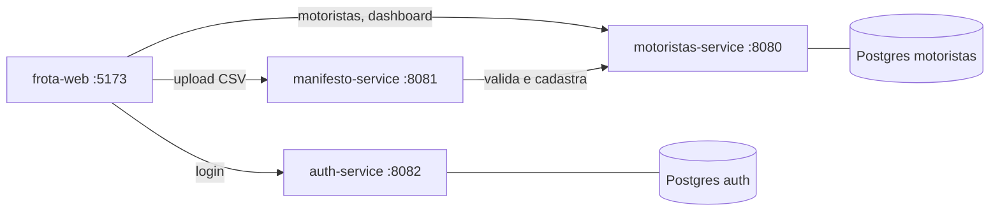

# NEWELOG — Repositório principal

> Projeto Integrador 3º Semestre · DSM · FATEC São José dos Campos  
> **Equipe:** Koitech-Log  
> **Cliente:** NEWE Logística Integrada

---

## 📖 Sobre

O **NEWELOG** é um sistema de gestão de frota com motoristas agregados da NEWE Logística Integrada. Ele cobre o cadastro de motoristas e veículos, a importação de manifestos em CSV, o dashboard de rentabilidade e a autenticação de usuários.

O sistema usa **microsserviços**, divididos por capacidade de negócio. Cada serviço fica no próprio repositório da organização [Koitech-Log](https://github.com/Koitech-Log). Este repositório reúne todos eles como **git submodules**, então um único clone traz o projeto inteiro.

A documentação de produto (problema, solução, backlog, sprints, DoR/DoD e padrão de commit) fica no repositório [Documentos](https://github.com/Koitech-Log/Documentos).

---

## 🧩 Serviços

| Serviço | Pasta | Repositório | Porta | Responsabilidade |
| :--- | :--- | :--- | :--- | :--- |
| Auth Service | `Backend/auth-service` | [newelog-auth-service](https://github.com/Koitech-Log/newelog-auth-service) | `8082` | Login, emissão de JWT e gestão de usuários |
| Motoristas Service | `Backend/motorista-service` | [newelog-motoristas-service](https://github.com/Koitech-Log/newelog-motoristas-service) | `8080` | Motoristas, veículos, viagens, dashboard financeiro e rentabilidade média |
| Manifesto Service | `Backend/manifesto-service` | [newelog-manifesto-service](https://github.com/Koitech-Log/newelog-manifesto-service) | `8081` | Importação de CSV (manifestos e veículos), integrada ao motoristas-service |
| Frontend | `frontend` | [newelog-frota-web](https://github.com/Koitech-Log/newelog-frota-web) | `5173` | Interface web (React + TypeScript + Vite): login, Visão geral, Motoristas e importações |

Todos os serviços de backend validam o mesmo **JWT (HS256)** emitido pelo `auth-service`. Por isso, o `JWT_SECRET` precisa ser **igual** em todos eles.



### Outros repositórios da organização

| Repositório | Papel |
| :--- | :--- |
| [Documentos](https://github.com/Koitech-Log/Documentos) | Documentação do projeto: backlog, sprints, DoR/DoD, equipe |
| [newelog-service-template](https://github.com/Koitech-Log/newelog-service-template) | Modelo-base (template do GitHub) para criar novos microsserviços |

### Planejados

A estratégia de microsserviços prevê ainda os itens abaixo, que **ainda não existem**:

| Item | Responsabilidade prevista |
| :--- | :--- |
| API Gateway (Spring Cloud Gateway) | Roteamento, agregação e CORS em um único ponto de entrada. Será implementado neste repositório; hoje a raiz só tem o esqueleto Spring Boot do template, e o front-end chama cada serviço direto |
| `newelog-ranking-service` | Pontuação e ranking mensal de motoristas e veículos, com regras de valorização de rotas (Sprint 3, Épico 12) |
| `newelog-export-service` | Geração de relatórios e planilhas sob demanda |
| `newelog-infra` | `docker-compose` único, scripts de bootstrap e documentação de arquitetura |
| `.github` | Workflows reutilizáveis, templates de issue/PR e perfil da organização |

---

## 🗓️ Sprints

| Sprint | Período | Entregas |
| :--- | :--- | :--- |
| 1 | 07/09 – 27/09 | Carga inicial e CRUD de motoristas, painel de disponibilidade, upload de manifesto |
| 2 | 05/10 – 25/10 | Login e perfis (Gestor/Operador), dashboard financeiro com rentabilidade média e filtro por mês, cadastro de veículos por CSV com validação e resumo |
| 3 | 02/11 – 22/11 | Em andamento: cadastro e gestão de usuários e perfis com histórico, regras de valorização de rotas e ranking mensal da frota |

Detalhes de cada sprint em [Documentos/Sprints](https://github.com/Koitech-Log/Documentos/tree/main/Sprints).

---

## 🛠️ Tecnologias

| Tecnologia | Uso |
| :--- | :--- |
| Java 21 + Spring Boot 3.5 | Microsserviços de backend |
| Spring Security + JWT | Autenticação e autorização |
| PostgreSQL 16 + Flyway | Banco de dados e migrations (auth e motoristas) |
| React + TypeScript + Vite | Frontend |
| Docker / Docker Compose | Execução local dos serviços e bancos |
| GitHub Actions | CI (build e testes) |

---

## 🚀 Como começar

```bash
# 1. Clone o repositório já com todos os submodules
git clone --recurse-submodules https://github.com/Koitech-Log/Koitech-Log-3DSM-Newelog.git
cd Koitech-Log-3DSM-Newelog

# Se já clonou sem --recurse-submodules:
git submodule update --init --recursive

# 2. Atualize os submodules para o último commit da main de cada serviço
git submodule update --remote
```

Depois, suba cada serviço seguindo o README dele. Ordem sugerida:

1. **auth-service:** `cd Backend/auth-service && cp .env.example .env && docker compose up --build`
2. **motorista-service:** `cd Backend/motorista-service && cp .env.example .env && docker compose up --build`
3. **manifesto-service:** `cd Backend/manifesto-service && cp .env.example .env && ./mvnw spring-boot:run`
4. **frontend:** `cd frontend && cp .env.example .env && npm install && npm run dev`

Acesse em `http://localhost:5173`.

> ⚠️ Preencha o `JWT_SECRET` com o **mesmo valor** em todos os `.env` de backend (mínimo de 32 caracteres; gere com `openssl rand -base64 48`).

---

## 📚 Documentação

| Documento | Conteúdo |
| :--- | :--- |
| [Estrutura do projeto](docs/ESTRUTURA-DO-PROJETO.md) | Organização das pastas, submodules e papel de cada serviço |
| [Modelo de branches](docs/MODELO-DE-BRANCHES.md) | Fluxo de trabalho com `main`, `develop` e branches de funcionalidade |
| [Documentos do projeto](https://github.com/Koitech-Log/Documentos) | Backlog, sprints, DoR/DoD e equipe |

---

## 🌿 Fluxo de trabalho (resumo)

```text
feature/* ──► develop ──► main
```

Cada funcionalidade é desenvolvida em uma branch própria a partir da `develop` e entra nela por Pull Request. Depois de testada, a `develop` é integrada à `main`, que guarda sempre a versão estável. Os detalhes estão em [docs/MODELO-DE-BRANCHES.md](docs/MODELO-DE-BRANCHES.md).
